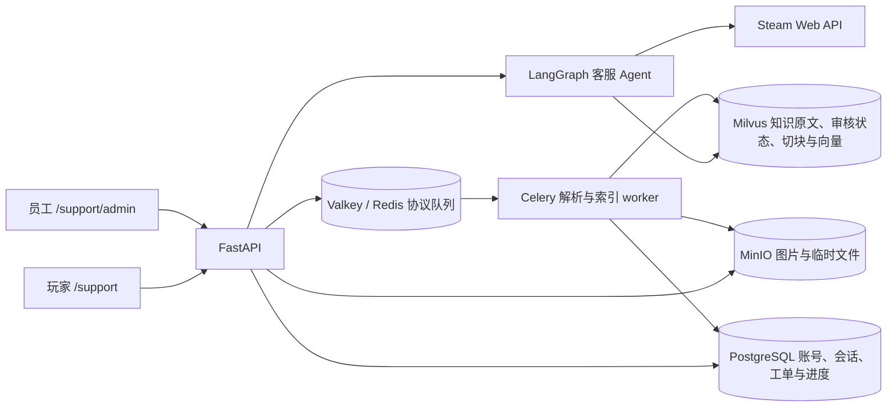

# DOTS Survivors 游戏客服 Agent

面向 [DOTS Survivors](https://store.steampowered.com/app/3326810/DOTS_Survivors/) 的玩家客服系统。玩家可登录后咨询游戏问题、查看自己的历史对话、提交问题并接收人工客服回复；员工可审核知识资料、处理工单和查看完整对话上下文。

**玩家入口：** `/support` · **员工入口：** `/support/admin` · **API 文档：** `/docs`

> English overview: A FastAPI and LangGraph player support application with account-bound conversations, reviewed knowledge, Milvus retrieval, tool calling, and staff handoff. See the [English operations guide](docs/game-support.md).

## 已实现的能力

| 模块 | 功能 |
| --- | --- |
| 玩家会话 | 账号注册与登录、按玩家隔离的历史记录、中文/英文/西班牙文界面、回答反馈与数据删除 |
| AI 客服 | LangGraph 对话流程、已发布资料检索、来源引用、无法核实时转交人工 |
| 工具调用 | 查询已发布知识、查询本人工单、创建人工转接工单；会话身份由服务端注入 |
| 员工工作台 | 工单领取、回复与状态管理；在原对话中继续服务玩家 |
| 统一文档知识库 | 手工编写正文，以及 TXT、MD、PDF、DOCX 和图片上传；草稿审核后发布 |
| RAG | 文档解析、本地 Tesseract OCR、切块、关键词候选、1024 维向量、统一 Milvus 检索与发布状态校验 |
| 图片 | 员工上传到私有 MinIO；审核图片描述后，玩家聊天可显示被引用的图片 |
| Steam API | 查询本游戏公开公告；玩家通过游戏客户端票据关联 Steam 后，核实本人游戏归属与成就 |

员工工作台只有一个文档知识库入口。文件上传和手工正文都进入 Celery 队列；页面持续显示解析、切块、向量化与索引进度。

## 技术结构



| 组件 | 用途 |
| --- | --- |
| FastAPI + LangGraph | 鉴权、客服 API、对话编排与工具调用 |
| Milvus | 知识原文、元数据、审核状态、关键词、切块和向量检索 |
| Celery + Valkey | 异步解析、OCR、向量化和重建索引 |
| PostgreSQL | 账号、会话、消息、工单、反馈和上传进度 |
| MinIO | 私有知识图片与临时待处理文件 |
| Steam Web API | 公告、已验证玩家的游戏归属与成就 |

AI 只使用已发布资料回答游戏事实。文档或条目修改后会回到草稿；员工复核来源、正文、切块和图片描述后再发布。高风险操作或资料不足时转人工，工单保留对话上下文。

## 快速启动（Windows PowerShell）

需要 Docker Desktop、Python 3.13 和 `uv`。复制配置模板，填入自己的数据库密码、JWT 密钥、MinIO 密钥及模型 API Key；不要把 `.env.development` 提交到仓库。

```powershell
Copy-Item .env.example .env.development
# 编辑 .env.development
docker compose --env-file .env.development up -d --build app support-worker
docker compose --env-file .env.development exec app /app/.venv/bin/alembic upgrade head
docker compose --env-file .env.development exec app /app/.venv/bin/python -m scripts.migrate_support_knowledge
```

打开 `http://127.0.0.1:8000/support`。Docker Compose 会启动 PostgreSQL、Valkey（Redis 协议）、MinIO、Milvus、etcd 和 Celery worker。最后一条命令会把初始化或旧版 PostgreSQL 中的知识资料写入 Milvus 并核对；可重复运行。

PowerShell 默认没有 GNU Make，直接运行上面的 `docker compose` 命令即可。纯本机 Python 启动、OCR 安装和常见问题见[中文运行指南](docs/game-support.zh-CN.md)。

## 配置员工账号

1. 在 `/support` 注册玩家账号，或在 `/docs` 调用 `POST /api/v1/auth/register`。
2. 将注册结果中的数字用户 ID 写入 `.env.development` 的 `SUPPORT_ADMIN_USER_IDS`；多个 ID 用逗号分隔。
3. 重启应用，在 `/support/admin` 登录。员工权限由服务端 ID 白名单控制。

```powershell
docker compose --env-file .env.development up -d --force-recreate app
```

## Steam API 接入

公开公告无需密钥。个人游戏归属、成就和 Steam 身份验证需要在服务器的 `.env.development` 设置 `STEAM_PUBLISHER_KEY`（有本游戏权限的 Steamworks Publisher Web API Key）；不要放入前端或提交到仓库。`STEAM_APP_ID` 默认为 `3326810`，`STEAM_TICKET_IDENTITY` 默认为 `dots-support`。设置后运行迁移并重启 API：

```powershell
docker compose --env-file .env.development exec app /app/.venv/bin/alembic upgrade head
docker compose --env-file .env.development up -d --force-recreate app
```

玩家先登录本系统。游戏客户端调用 Steamworks `GetAuthTicketForWebApi("dots-support")`，将票据字节转换为十六进制后，以玩家 JWT 调用 `POST /api/v1/steam/link`，请求体为 `{"ticket":"..."}`。服务端向 Steam 验证票据，只保存返回的 SteamID；票据不落库。`DELETE /api/v1/steam/link` 可解除关联。网站页面本身不能生成游戏客户端的 Steamworks 票据，因此个人数据功能需游戏客户端接入后才能使用。

玩家可在聊天里问“Steam 最新公告”“我拥有这款游戏吗”“我的 Steam 成就”，或用 JWT 调用 `POST /api/v1/support/tools/get_steam_news`、`check_my_steam_ownership`、`get_my_steam_achievements`（请求体 `{"arguments":{}}`）。个人查询只使用服务端保存的关联 SteamID；不能通过请求参数指定其他玩家。Steam API 故障会返回暂时不可用，不会推断归属或成就。公告来源为 [Steam News API](https://partner.steamgames.com/doc/webapi/ISteamNews)，身份验证、归属和成就分别使用 Steamworks 的 [ISteamUserAuth](https://partner.steamgames.com/doc/webapi/ISteamUserAuth)、[ISteamUser](https://partner.steamgames.com/doc/webapi/ISteamUser) 与 [ISteamUserStats](https://partner.steamgames.com/doc/webapi/ISteamUserStats)。

## 知识库使用流程

1. 员工在同一个文档知识库中建立正文，或上传不超过 50 MiB 的 TXT、MD、PDF、DOCX、PNG、JPG、WEBP 文件。
2. Celery worker 提取文字与图片中的 OCR 文本，按段切分，生成关键词候选和向量。员工可查看正文、切块和实时处理进度。
3. 员工核对来源、游戏版本、关键词及图片描述后发布。只有已发布内容会进入玩家问答。
4. 更改已发布资料或重建索引后，需重新审核并发布。切换 embedding 模型后，可在工作台逐份重建索引。

Milvus 的 `support_catalog_v1` collection 保存文档元数据、原文、审核状态、关键词、切块和图片描述向量；图片二进制保存在 MinIO。PostgreSQL 不再参与知识检索或审核，旧表仅供迁移。迁移核对成功且新工作台可用后，可运行 `python -m scripts.migrate_support_knowledge --purge-legacy` 清理旧表数据。Milvus 不可用时，知识检索不可用。详细限制、图片处理和模型配置见[中文运行指南](docs/game-support.zh-CN.md)。

## 开发与验证

```powershell
uv sync
uv run ruff check .
uv run pyright
uv run pytest tests
```

需要数据库的集成测试须先启动依赖并完成迁移，再设置 `SUPPORT_INTEGRATION=1`。API 位于 `app/api/v1/`，客服业务逻辑位于 `app/services/`，前端静态文件位于 `app/static/support/`，迁移位于 `alembic/versions/`。

## Benchmark / 评测

客服已有 `evals/support_eval.py`：逐条调用当前客服回答流程，统计转人工准确率、漏转/误转、来源引用覆盖和整条回答耗时。运行前需配置应用数据库、知识库和模型；默认数据集 `evals/support_cases.jsonl` 是 18 条中英西语回归样本，可用 `--baseline` 与已有报告比较。

```powershell
uv run python -m evals.support_eval --output evals/reports/support.json --baseline evals/baselines/v1.3.1.json
```

现有引用指标只检查预期来源是否出现，不能代替回答事实正确率。18 条样本也不足以支持生产环境准确率结论；扩大样本后需要人工审核预期答案与来源。

`evals/vllm_benchmark.py` 单独请求运行中的 OpenAI 兼容 vLLM 服务，统计流式首内容 token 时间（TTFT）的 P50/P95 和总输出 token/s。默认复用上述问题作为提示词；脚本不经过 LangGraph、Milvus 或客服 API，因此结果仅代表模型服务吞吐。服务必须在流式响应中返回 `usage.completion_tokens`，否则吞吐字段为 `null`；API Key 可从 `VLLM_API_KEY` 环境变量读取，报告不保存密钥。

```powershell
uv run python -m evals.vllm_benchmark --base-url http://127.0.0.1:8000/v1 --model "YOUR_MODEL_ID" --hardware "YOUR_GPU" --vllm-version "YOUR_VLLM_VERSION" --input evals/support_cases.jsonl --concurrency 4 --max-tokens 256 --output evals/reports/vllm.json
```

记录 GPU、模型及量化版本、vLLM 版本、输入和输出 token 数、并发数后再比较不同运行结果。本仓库没有针对当前部署运行这项 Benchmark，也没有可据此确认的显卡或模型名称。

## 文档与许可

- [中文运行指南](docs/game-support.zh-CN.md)
- [English operations guide](docs/game-support.md)
- [数据库说明](docs/database.md)
- [MIT 许可证](LICENSE)

游戏客服功能由本仓库维护者开发，项目沿用 FastAPI LangGraph Agent 模板作为基础。原模板及其贡献者的提交历史和 MIT 版权声明保留在仓库中。
